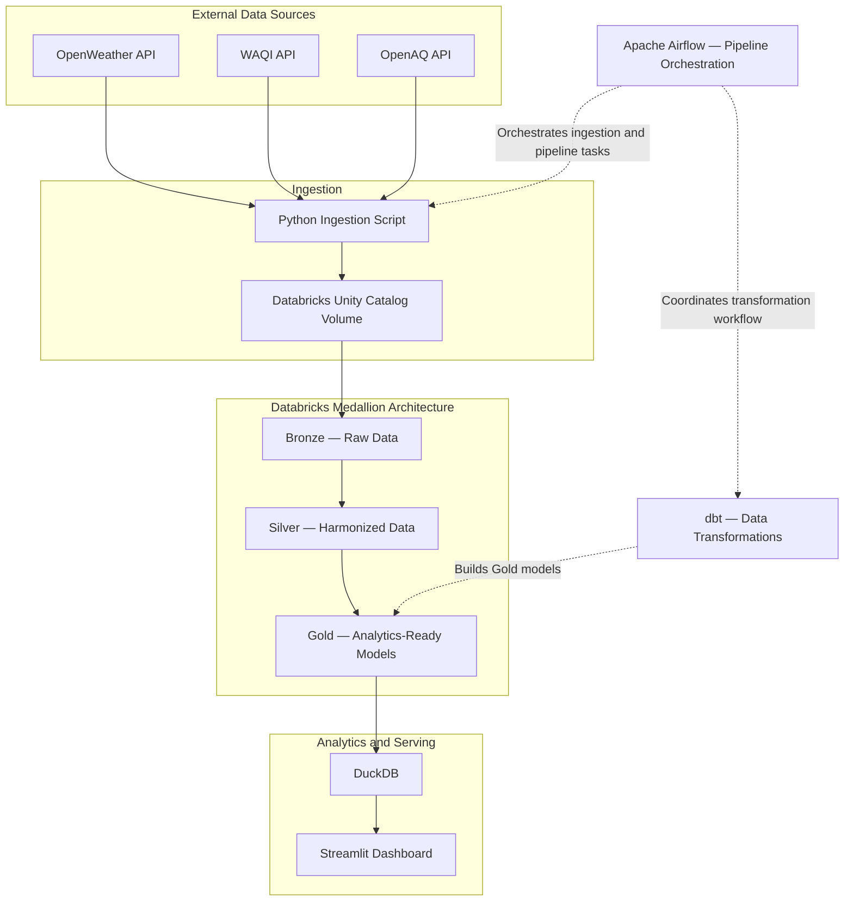

# AirLens 🌎
### End-to-End Environmental Data Engineering Platform

AirLens is an end-to-end data engineering project that integrates weather and air-quality data from public APIs into an analytics-ready data platform. It demonstrates how to ingest data from multiple external sources, organize and transform it using a medallion architecture, orchestrate the pipeline, and serve curated datasets through an interactive dashboard.

The project combines **Python, Databricks, dbt, Apache Airflow, DuckDB, and Streamlit** to demonstrate a complete workflow from API ingestion to data exploration.

## Architecture

### Pipeline Overview

1. **Data ingestion:** Python retrieves environmental data from the OpenWeather, World Air Quality Index (WAQI), and OpenAQ APIs and uploads the ingested data to a Databricks Unity Catalog Volume.
2. **Bronze layer:** Raw source data is organized in the Bronze layer to preserve source-level information for downstream processing.
3. **Silver layer:** Data from multiple sources is harmonized into a more consistent structure for analysis.
4. **Gold layer:** dbt models transform curated data into analytics-ready datasets within Databricks.
5. **Serving layer:** DuckDB reads the Gold-layer output and provides a queryable layer for downstream analytics.
6. **Dashboard:** Streamlit presents environmental data through an interactive interface.
7. **Orchestration:** Apache Airflow automates the end-to-end workflow, coordinating ingestion, Databricks processing, dbt model builds, and downstream analytics refreshes.

## Technology Stack

| Technology | Purpose |
|---|---|
| Python | API integration and data ingestion |
| REST APIs | External weather and air-quality data sources |
| Databricks Free Edition | Lakehouse processing and medallion architecture |
| Unity Catalog Volumes | Storage and transfer of ingested files |
| SQL | Data transformation and analytical querying |
| dbt | SQL-based transformation models and Gold-layer builds |
| Apache Airflow | End-to-end pipeline orchestration |
| DuckDB | Querying curated data for downstream analytics |
| Streamlit | Interactive dashboard and data exploration |

## Data Sources

AirLens integrates three public data sources:

- [OpenWeather](https://openweathermap.org/api) — weather and atmospheric data.
- [World Air Quality Index (WAQI)](https://aqicn.org/api/) — air-quality observations.
- [OpenAQ](https://openaq.org/) — air-quality measurements from monitoring sources.

These sources provide complementary perspectives on environmental conditions and support analysis across weather and air-quality datasets.

## Engineering Concepts Demonstrated

### Multi-source API ingestion
Integrates multiple external APIs into a shared data pipeline, bringing together data from different source systems.

### Medallion architecture
Separates raw ingestion, harmonized data, and analytics-ready outputs into Bronze, Silver, and Gold layers.

### Data transformation with dbt
Uses dbt to build transformation models in Databricks, creating curated datasets for downstream consumption.

### Workflow orchestration with Airflow
Automates the end-to-end pipeline, coordinating ingestion and transformation tasks so the workflow can run without manually triggering each stage.

### Decoupled analytics serving
Uses DuckDB as a query layer between curated data and the Streamlit dashboard, separating data processing from data presentation.

## Getting Started

AirLens depends on external API access, a configured Databricks environment, and the project's Python, dbt, and Airflow setup.

### Prerequisites

- Python environment with the project's dependencies installed
- Access credentials or API keys required by the selected data sources
- Databricks Free Edition workspace with the required Unity Catalog resources
- dbt configured to connect to the Databricks target
- Apache Airflow configured to run the project's ingestion and processing workflow

### Configuration

Before running the pipeline, configure the credentials, connection settings, and environment-specific values required by the API integrations, Databricks, dbt, and Airflow.

**Keep secrets out of source control.** Use the project's configured environment variables or secret-management mechanism for credentials.

### Running the Pipeline

The intended workflow is:

1. Configure API access and the Databricks environment.
2. Run the Airflow workflow to orchestrate the pipeline.
3. Allow the ingestion and Databricks processing steps to execute.
4. Build the dbt models in Databricks as part of the orchestrated workflow.
5. Refresh or query the curated data through DuckDB and explore it in Streamlit.

Refer to the repository's scripts, configuration files, and Airflow DAG for the exact deployment and execution commands.

## Project Goals

AirLens was built to demonstrate practical data engineering skills across the full data lifecycle:

- Integrating multiple external data sources.
- Ingesting data into a lakehouse environment.
- Organizing datasets using a Bronze/Silver/Gold medallion architecture.
- Transforming data with SQL and dbt.
- Orchestrating an end-to-end pipeline with Apache Airflow.
- Serving curated data through DuckDB.
- Enabling interactive analysis with Streamlit.

## Future Enhancements

Potential future improvements include expanding automated data quality checks, strengthening observability and failure alerting, and extending analytical models and dashboard capabilities.

---

**Built as a hands-on data engineering portfolio project** to explore modern lakehouse architecture, orchestration, transformation, and analytics delivery.
