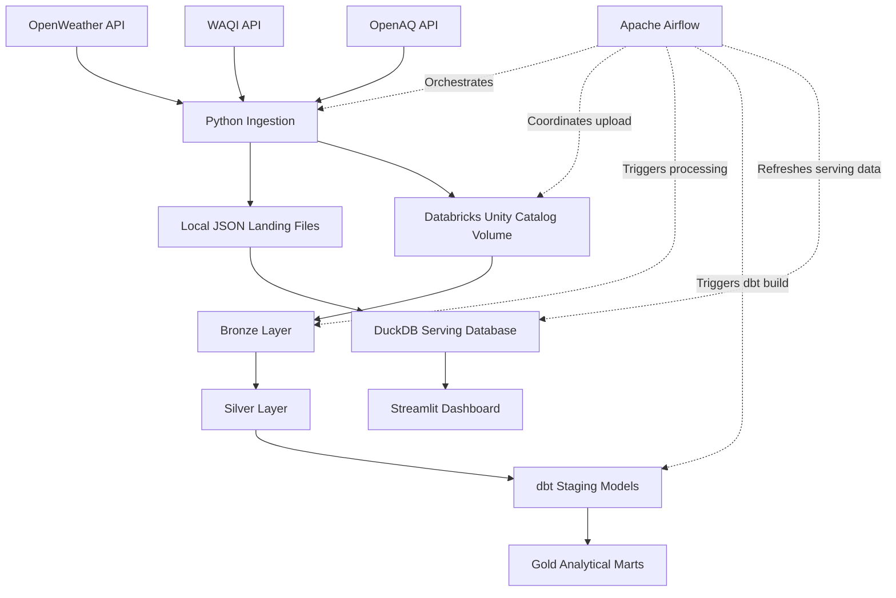
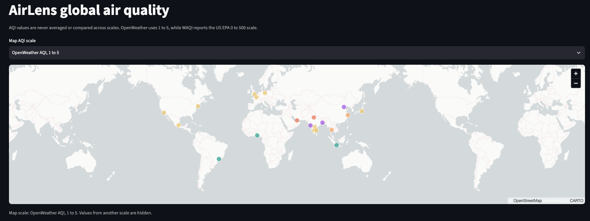
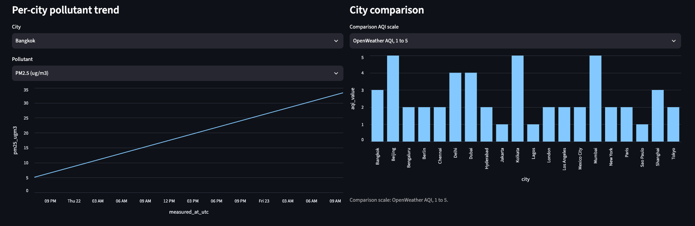
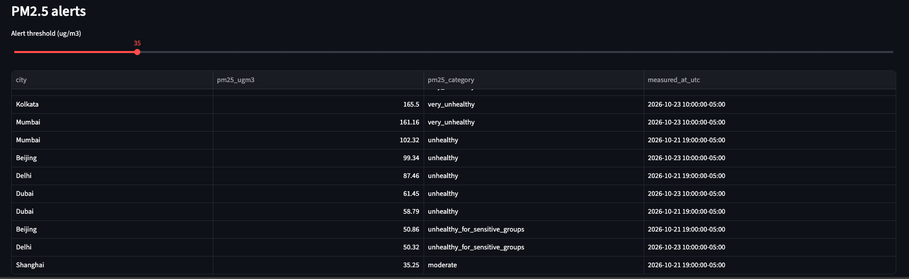

# AirLens 🌎
### Environmental Data Engineering with Databricks, dbt, and Airflow

AirLens is an end-to-end data engineering project that collects environmental data from public APIs, orchestrates ingestion and cloud processing, transforms data into analytical models, and serves interactive visualizations through Streamlit.

The project demonstrates modern data engineering practices, including API ingestion, medallion architecture, data harmonization, SQL-based transformations, workflow orchestration, data quality testing, and analytical serving.

A key architectural decision is the separation of **cloud data processing from interactive dashboard serving**. Databricks and dbt handle cloud-based processing and analytical modeling, while DuckDB and Streamlit provide a lightweight local analytics experience without triggering cloud compute for each dashboard interaction.

AirLens demonstrates practical experience with:

- Building Python-based ingestion pipelines from multiple public APIs.
- Designing a medallion architecture in Databricks.
- Harmonizing data from sources with different structures and measurement conventions.
- Developing reusable SQL transformations and analytical marts with dbt.
- Applying data quality tests and incremental modeling strategies.
- Orchestrating dependent workflows with Apache Airflow.
- Separating cloud transformation workloads from interactive analytical serving.
- Building a lightweight analytics interface with DuckDB and Streamlit.
- Considering data freshness, source traceability, and cloud compute efficiency in architectural decisions.

## Architecture

The architecture contains two complementary data paths coordinated by Airflow:

- **Cloud processing path:** API data is uploaded to a Databricks Unity Catalog Volume, processed through Bronze and Silver layers, and modeled into Gold analytical marts using dbt.
- **Local serving path:** Locally landed JSON data is loaded into DuckDB, which powers the Streamlit dashboard.

The paths are intentionally decoupled. The dashboard queries DuckDB rather than directly querying Databricks Gold marts. This keeps interactive filtering independent of Databricks compute and avoids initiating cloud workloads for routine dashboard interactions.

## Technology Stack

| Technology | Purpose |
|---|---|
| Python | API ingestion, data handling, and local serving-data preparation |
| Apache Airflow | Workflow orchestration, scheduling, retries, and task dependencies |
| Databricks | Cloud-based data processing and medallion architecture |
| Unity Catalog Volumes | Storage for ingested source files |
| dbt | SQL transformations, analytical modeling, and data quality tests |
| DuckDB | Local analytical serving database |
| Streamlit | Interactive environmental analytics dashboard |
| Docker Compose | Local Airflow environment |
| uv | Python dependency and project management |

## Data Sources

AirLens integrates three public environmental data APIs:

- **OpenWeather:** Weather observations and related atmospheric conditions.
- **World Air Quality Index (WAQI):** Air quality observations and station-level information.
- **OpenAQ:** Open air quality measurements and monitoring-station data.

The ingestion process queries configured cities, collects source responses, and preserves the original payloads for downstream processing.

Source records are stored in JSON envelopes containing metadata such as the source, city, ingestion run identifier, fetch timestamp, and original API response.

The ingestion workflow includes request timeouts, retry handling with exponential backoff for applicable rate-limit and server errors, and separate handling for authentication failures.

## Data Pipeline

### 1. API ingestion

A Python ingestion script retrieves data from the three APIs for configured cities and writes the results to local JSON landing files.

The local files provide an input to the DuckDB serving workflow and are also uploaded to Databricks for cloud processing.

### 2. Databricks medallion architecture

Ingested files are uploaded to a Databricks Unity Catalog Volume and processed through Bronze and Silver layers.

- **Bronze:** Preserves source-specific raw data for traceability and downstream processing.
- **Silver:** Harmonizes data from multiple sources into consistent structures suitable for analytical modeling.

This layered approach separates source ingestion from data standardization and prepares data for downstream transformations.

### 3. dbt transformations and Gold marts

A dbt Cloud job builds staging models and analytical marts on Databricks.

The project includes staging models for weather, air quality, and monitoring stations, along with three analytical marts:

| Model | Purpose |
|---|---|
| `mart_city_air_quality` | Organizes hourly city-level air quality measurements by source and retains the corresponding AQI scale. |
| `mart_city_daily` | Produces incremental daily analytical data using a merge strategy and a defined unique key. |
| `mart_station_coverage` | Provides city-level monitoring coverage information. |

The models support downstream analysis while applying consistent transformation logic and data quality checks.

### 4. Local analytics with DuckDB

DuckDB provides a lightweight analytical serving layer for the dashboard.

The serving script reads the local JSON landing files, prepares analytical tables, and refreshes the local DuckDB database.

This design avoids requiring a cloud database query for each dashboard interaction. Users can change filters and explore the locally available data without triggering Databricks jobs.

**Important architectural distinction:** DuckDB currently builds its serving tables from local landing files, not from the dbt Gold marts. The cloud transformation path and local serving path are orchestrated together but remain separate data paths.

### 5. Interactive Streamlit dashboard

The Streamlit dashboard provides an interactive interface for exploring environmental conditions.

Dashboard capabilities include:

- Global air quality mapping.
- Pollutant trends for selected cities.
- Air quality comparisons across cities.
- Configurable PM2.5 threshold alerts.
- Monitoring-station coverage.

The dashboard queries DuckDB, allowing users to adjust filters without launching cloud processing. Data freshness depends on the most recent local data refres. Airflow is used to try to ensure freshness as the local DuckDb refresh step is the last task in the pipeline DAG.

## Data Quality and Modeling Considerations

AirLens incorporates data validation and explicit handling of differences between environmental data sources.

- **dbt tests:** Schema-level checks include `not_null`, `unique`, and `accepted_values` tests where appropriate.
- **Incremental modeling:** The daily analytical mart uses an incremental merge strategy with a defined unique key.
- **AQI scale preservation:** OpenWeather's 1–5 air quality index and WAQI's US EPA-style 0–500 index are treated as distinct scales rather than averaged or compared as equivalent values.
- **Source traceability:** Ingestion metadata preserves source identity and fetch timing.
- **PM2.5 interpretation:** Dashboard categories are descriptive snapshot classifications, not substitutes for regulatory assessments based on time-weighted averages.

These practices help maintain consistency and make the limitations of multi-source environmental data explicit.

## Workflow Orchestration with Airflow

Apache Airflow coordinates the pipeline through the `airlens_daily_pipeline` DAG.

The workflow is configured for daily scheduling and includes task dependencies, retry behavior, exponential backoff, and execution timeouts.

The main tasks are:

1. `ingest_apis` — Collect environmental data from public APIs.
2. `upload_to_volume` — Upload the ingested files to a Databricks Unity Catalog Volume.
3. `run_bronze_silver` — Trigger Databricks Bronze and Silver processing.
4. `trigger_dbt_cloud_job` — Trigger dbt transformations and analytical model builds.
5. `refresh_duckdb` — Refresh the local DuckDB serving database.

The scheduled pipeline coordinates both cloud processing and local serving-data refreshes. The dashboard itself does not trigger the DAG when users adjust filters.

## Project Objectives

AirLens demonstrates practical experience with:

- Building Python-based ingestion pipelines from multiple public APIs.
- Designing a medallion architecture in Databricks.
- Harmonizing data from sources with different structures and measurement conventions.
- Developing reusable SQL transformations and analytical marts with dbt.
- Applying data quality tests and incremental modeling strategies.
- Orchestrating dependent workflows with Apache Airflow.
- Separating cloud transformation workloads from interactive analytical serving.
- Building a lightweight analytics interface with DuckDB and Streamlit.
- Considering data freshness, source traceability, and cloud compute efficiency in architectural decisions.

## Future Enhancements

Potential extensions include automated pipeline health reporting, expanded data quality monitoring, improved failure notifications, and an optional serving path that consumes published Gold marts when a unified cloud-to-dashboard data lineage is desirable.

---

**AirLens** brings together cloud data engineering, workflow orchestration, analytical modeling, and interactive data exploration in a single portfolio project.
